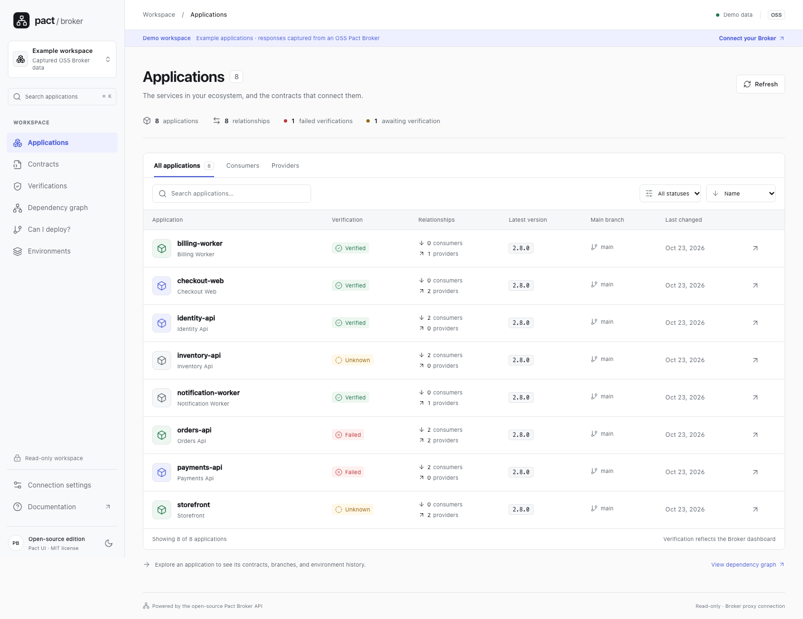

# Pact UI

A modern, read-only workspace for the open-source Pact Broker. Connect an existing self-hosted Broker; no backend changes or additional database required.



## Run locally

Requires Node.js 22.12+ and npm.

```sh
npm ci
cp .env.example .env.local
# Set PACT_BROKER_URL to a Broker reachable from this machine.
npm run dev
```

Open [localhost:3000](http://localhost:3000). For a captured-data preview, open [demo mode](http://localhost:3000/applications?demo=true) or select **Use demo data** in Connection settings.

Demo mode is explicitly labeled and serves actual responses captured from a disposable OSS Broker with synthetic applications. It never substitutes demo data for a failed live connection.

## Connect a Broker

The Next.js app includes a same-origin, read-only Broker proxy. The browser calls `/api/broker`; the server calls the Broker. No Broker CORS changes are required, and no additional database is needed.

Set the default URL at runtime, including any base path:

```dotenv
PACT_BROKER_URL=https://broker.example.com/pact
```

In **Connection settings**, select **Basic authentication** and enter your existing Broker username/password. Each user supplies their own credentials. The app forwards them only with that user's requests; it does not create accounts, store passwords on the server, or share a deployment credential. Entered passwords/tokens stay in browser memory and must be reentered after reload. URL preferences are saved locally. Changing connections clears cached Broker data.

The Broker enforces the user's existing permissions. Anonymous reads are available through **No authentication**; **Bearer token** is available for deployments with custom token support. The stock OSS Broker uses Basic auth. Browser sessions/cookies from the Broker's original UI are not forwarded through the proxy. Use HTTPS for the app and the Broker in production.

### Configurable Broker URLs

`PACT_BROKER_URL` supplies the default displayed by `/api/config` and is automatically allowed by the proxy. To allow users to select additional Brokers, configure a comma-separated list:

```dotenv
PACT_BROKER_URL=https://broker.example.com/pact
PACT_BROKER_ALLOWED_URLS=https://staging-broker.example.com,https://another.example.com/broker
```

Connection settings can select any of these exact normalized URLs, including the base path. Other destinations are rejected before credentials or requests are sent. The allowlist prevents use as an arbitrary forwarding endpoint. The server rejects writes and redirects, bounds responses to 10 MiB, applies a 15-second upstream timeout, and disables response caching. Broker cookies, authentication challenges, and upstream redirect locations are not forwarded to the browser.

These are runtime variables: changing them and restarting the app/container needs no rebuild. No credentials belong in environment configuration. See [.env.example](.env.example).

## Production

```sh
npm run build
npm start
```

Next.js serves the UI and API proxy on port 3000. Routes are normal paths such as `/applications` and `/settings`.

## Included workflows

- Searchable application directory with role/status filters and activity sorting.
- Application relationships, versions, branches, contracts, deployments, and releases.
- Searchable HTTP/message contract interactions, syntax-colored JSON, and structural version comparison.
- Verification evidence, provider context, CI build links when reported, and matrix history (up to 100 rows per relationship).
- React Flow dependency graph with search, pan, zoom, and transitive upstream/downstream highlighting.
- `can-i-deploy` checks by version or resolved branch against an environment, preserving Broker `true` / `false` / `null` semantics.
- Current environment deployments and supported releases.
- Light/dark themes, keyboard navigation, loading/empty/error states, responsive layout.

The UI is read-only. The generated client includes Broker write endpoints for independent use; both the UI transport and server proxy reject mutations. Webhook APIs are covered in the API specification, but there is no webhook administration UI.

## API provenance and regeneration

The OpenAPI 3.1 specification comes from live route and dry-validation introspection of Pact Broker commit [`e27e1135f7398cd05ac8bbad9698eae15f9c4d0a`](https://github.com/pact-foundation/pact_broker/tree/e27e1135f7398cd05ac8bbad9698eae15f9c4d0a), Roar serializer declarations, the existing upstream OAS, and captured upstream request tests.

It covers 104 route templates and 259 methods, including OPTIONS and the two optional diagnostic routes. **Complete route inventory does not mean complete schema proof.** Unobserved or conditional shapes remain explicitly uncertain. Read [API coverage and limitations](docs/api-coverage.md), [generation research](docs/research/openapi-generation-options.md), and [OpenAPI artifacts](openapi/README.md).

```sh
npm run api:assemble   # Reassemble spec + types from checked-in evidence
npm run api:validate   # OpenAPI validation
npm run api:coverage   # Compare every path/method with the inventory
npm run api:check      # Detect stale generated TypeScript
```

For fresh Ruby extraction (requires Ruby 3.2+, Bundler and network access):

```sh
tools/openapi/regenerate.sh
```

This uses a pinned disposable checkout. The checked-in Ruby lockfile records the generation environment's dependencies. No upstream source modification is required; route introspection and temporary test instrumentation supply the evidence. The generator correctly distinguishes wire bodies/query parameters from internal Ruby validation structures.

## Project structure

```text
openapi/                 Standalone YAML, source inventory, observations, reports
src/lib/api/schema.d.ts   Generated only; never edit
src/lib/api/              Typed client, safe HAL traversal, pagination
src/lib/domain/           Runtime models, queries, comparison and status logic
src/lib/connection/       Public runtime configuration and browser preferences
src/lib/demo/             Captured seeded Broker responses
src/components/           Product views and shadcn-style Radix/CVA primitives
src/app/                  Next.js App Router pages and API handlers
src/lib/server/           Runtime URL allowlist and stateless Broker proxy
src/styles.css            Shared interface styles
tools/openapi/            Reproducible extraction, assembly, validation
tools/demo/               Seed/capture a disposable real OSS Broker
tests/                    Unit, component, real-Broker, and browser checks
```

The Button follows the shadcn/ui Radix Slot/CVA pattern; other controls use native semantic elements. No persistent app database, custom credential store, or Broker migration is needed.

## Validation

```sh
npm test
npm run typecheck
npm run build
npx playwright install chromium
npm run test:e2e
```

For an end-to-end Docker test against the official Pact Broker and PostgreSQL:

```sh
npm run test:docker
```

This builds the actual UI Dockerfile and starts the isolated `pact-ui-real-e2e` Compose project on localhost ports 3002 (UI) and 9296 (Broker). It publishes contracts, verifications, branches and deployments through the real Broker API, then runs desktop/mobile Chromium checks with read-only and admin Basic auth users. No response fixtures or demo mode are used. Broker and PostgreSQL images are pinned by digest in `tools/testing/compose.real.yaml`. The runner removes its containers and disposable database afterward, including on failure. It requires Docker and the Chromium installation shown above. The credentials in this test stack are test-only. GitHub Actions runs this real-Broker Docker suite on pushes and pull requests, retains failure traces, and always attempts stack cleanup.

Real OSS Broker integration checks run against a disposable seeded instance, never production:

```sh
# In a pinned upstream checkout with dependencies installed:
PACT_UI_SERVE=true bundle exec ruby -Ilib /absolute/path/to/pact-ui/tools/demo/capture.rb /tmp/demo.json
# In this project, from another terminal:
PACT_TEST_BROKER_URL=http://127.0.0.1:9293 npm run test:integration
```

The integration suite publishes a test participant. CI prepares its own pinned in-memory Broker. Without `PACT_TEST_BROKER_URL`, these integration tests skip explicitly.

Local validation: production build, generated-type check, route coverage, unit/component tests, real Broker integration tests, and desktop/mobile Playwright workflows were run. The upstream capture run had one approval fixture mismatch (metadata URLs contain different internal consumer-version IDs) and one existing pending example. Its full result is preserved in `openapi/upstream-test-results.log`; it is not reported as a green upstream suite.

## Docker

```sh
cp .env.example .env.local
# Set PACT_BROKER_URL to a URL reachable from inside the container.
docker compose --env-file .env.local up --build
```

Open [localhost:3000](http://localhost:3000), then enter your personal Broker credentials in Connection settings. The multi-stage Dockerfile builds Next.js standalone output and runs it as the non-root `node` user. There is one app container; it needs no companion proxy, authentication service, or app database.

For a Broker on the Docker host, use `http://host.docker.internal:9292` (Compose includes the host-gateway mapping). For a Broker on the same Docker network, use its service name. The URL must be reachable from the app server, not necessarily from the browser. For demo mode, set `PACT_UI_DEMO=true`.

You can also run the image directly:

```sh
docker build -t pact-ui .
docker run --rm -p 3000:3000 \
  -e PACT_BROKER_URL=https://broker.example.com pact-ui
```

See [delivery notes](docs/delivery.md) for validation and limitations.

## License

MIT. Upstream-derived API/fixture material retains the Pact Broker [MIT license](openapi/UPSTREAM-LICENSE.txt).
